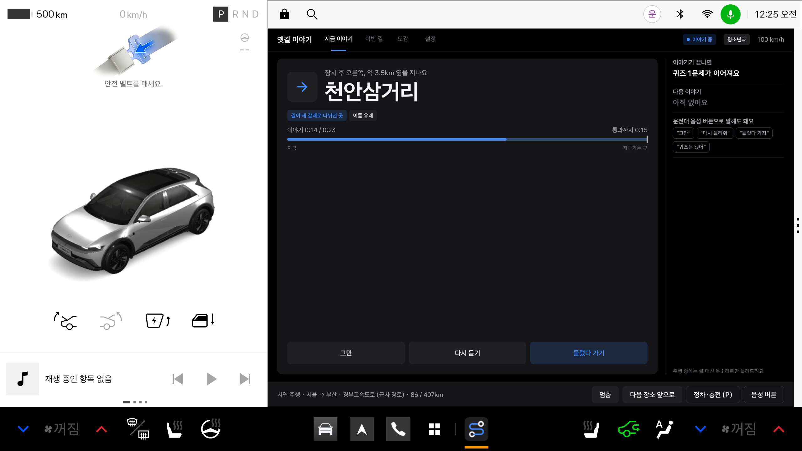
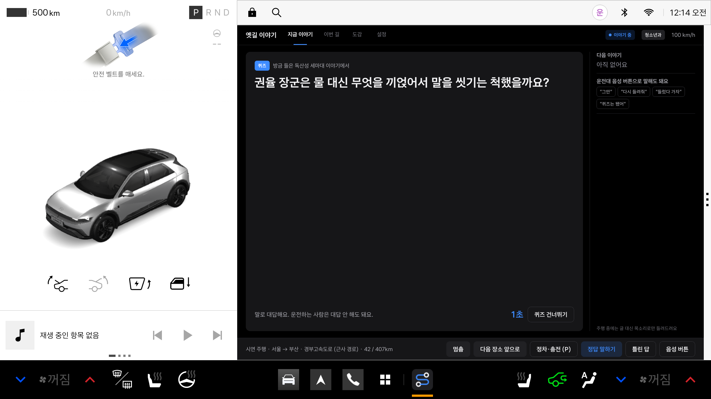
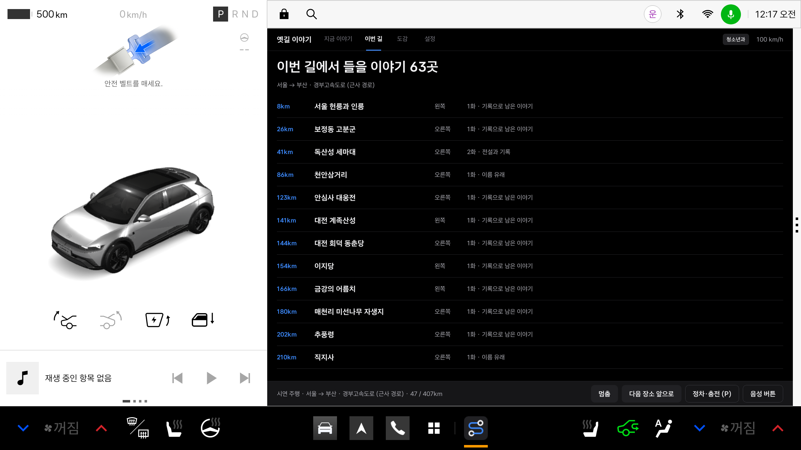

# 옛길 이야기

옛길 이야기는 차가 역사 유적 옆을 지날 때, 그곳을 지나기 전에 끝나도록 그 장소에 얽힌 이야기를 들려주는 Pleos Connect 앱입니다.



## 왜 만들었나

명절 귀성길 고속도로에서는 독산성, 천안삼거리, 추풍령 같은 지명이 표지판에 줄줄이 스쳐 갑니다. 교과서에서 한 번쯤 본 이름이지만 운전자는 찾아볼 틈이 없습니다. 동승자가 휴대폰으로 검색해 읽어 줄 무렵이면 차는 이미 그 앞을 지나 있습니다. 뒷좌석 아이들은 대개 영상을 봅니다.

차는 지금 위치와 속도, 가는 방향을 알고 있습니다. 앱이 이 정보를 쓰면 "1분 뒤 오른쪽에 독산성"이라는 계산이 나오고, 1분 안에 끝나는 이야기를 골라 틀 수 있습니다. 휴대폰 오디오 가이드로는 맞추기 힘든 타이밍이어서 차량 앱으로 만들었습니다.

## 주요 기능

앱은 장소에 가장 가까워지는 시점과 좌우 방향을 계산합니다. 남은 시간이 짧으면 25초, 넉넉하면 90초 분량을 골라 그 시간 안에 재생을 마칩니다.

운전 중에는 안내와 해설을 귀로만 들으면 됩니다. 화면에는 장소 이름과 방향, 그리고 '그만', '다시 듣기', '들렀다 가기' 버튼 세 개만 뜹니다.

해설이 끝나면 퀴즈가 이어집니다. 아이들이 말로 답하면 앱이 알아듣고 정답을 알려 줍니다. 같은 길을 다시 지나면 복습 퀴즈가 나옵니다. 장소마다 원고를 여러 편 넣었고, 한 번 들은 편은 1년 동안 다시 나오지 않습니다.

기어를 P에 두거나 충전구를 열면 근처 유적의 긴 해설이 글과 함께 나옵니다.

듣는 사람은 '아이와 함께', '청소년과', '어른끼리' 가운데 고릅니다. '아이와 함께'를 고르면 아이 눈높이에 맞춰 따로 쓴 원고만 재생됩니다.

| 퀴즈 | 이번 길 미리보기 |
| --- | --- |
|  |  |

## 실행 방법

출품용 APK는 `apk/` 폴더에 있습니다. Pleos Connect Emulator v2.1.0(Android 14, API 34, x86_64)에서 동작을 확인했고, 따로 설정할 것은 없습니다.

1. Pleos Connect Emulator를 cold boot로 켭니다. 설치 방법은 Pleos Playground 개발자 가이드에 나와 있습니다. 내비 지도가 다 뜰 때까지 기다려 주세요.
2. `adb install -r -g apk/옛길이야기_옛길이야기_release.apk`로 설치한 뒤 하단 독이나 앱 목록에서 '옛길 이야기'를 엽니다.
3. 주행은 화면 아래 시연용 버튼으로 재현합니다.
   - 출발: 서울에서 부산까지 경부고속도로를 시속 100km로 달립니다.
   - 다음 장소 앞으로: 다섯 번 누르면 독산성 세마대에 닿고, 해설과 퀴즈가 이어집니다.
   - 정차·충전 (P): 차를 세운 상태로 바꿉니다.
   - 시연 중 퀴즈는 4초 뒤 정답을 말한 것으로 처리됩니다. 마이크가 있으면 직접 답해도 됩니다.

## Pleos SDK 활용

음성은 Gleo AI TextToSpeech와 SpeechToText가 맡습니다. TextToSpeech는 안내와 해설을 읽고, 낭독이 끝났다는 신호를 받아 퀴즈를 시작합니다. SpeechToText는 "그만", "다시 들려줘", "들렀다 가자" 같은 명령과 퀴즈 답을 알아듣습니다.

정차 여부는 Vehicle SDK의 기어와 충전구 신호로 판단합니다. 위치와 진행 방향은 FusedLocation에서 1초마다 받습니다. NaviHelper로는 목적지를 받아 '이번 길' 미리보기를 만들고, 운전자가 '들렀다 가기'를 누르면 그 장소를 경유지로 넣습니다.

## 이야기 데이터

데이터는 경부고속도로 시연 구간을 중심으로 101곳, 196편입니다. 퀴즈는 8개, 정차 중에 들려줄 긴 해설은 23편입니다.

유적 설명은 국가유산청 국가유산 검색 API에서, 한국관광공사 관광지 오디오 가이드(오디) 해설과 한국천문연구원 특일 정보는 공공데이터포털에서 받았습니다. 이 가운데 역사와 관련된 해설만 골랐고, "앞에 보이는", "이쪽으로 걸어가시면"처럼 현장에서나 맞는 문장은 걸러 냈습니다. 특일 정보는 설날·추석과 24절기 인사에 씁니다.

독산성 세마대, 천안삼거리, 추풍령, 직지사, 통도사, 범어사 여섯 곳은 아이용 원고를 따로 썼습니다. 전설과 기록은 나눠서 들려주며, 장소별 원고와 출처는 [docs/review-checklist.md](docs/review-checklist.md)에 모아 두었습니다.

## 소스 구조

```
engine/      지나갈 장소 예측, 재생 길이 결정, 편 순환, 퀴즈 채점 (순수 Kotlin, SDK 없이 테스트)
app/         차량 앱. Pleos SDK 연결과 Jetpack Compose 화면
collector/   국가유산청·관광공사·특일 정보 수집 도구와 데이터 검사
simulator/   실차 없이 엔진을 돌려 보는 가상 주행
data/        이야기 데이터(packs), 시연 경로(routes), 특일(special-days)
docs/design/ 화면 시안과 디자인 토큰
```

소스에서 빌드할 때는 아래 명령을 씁니다. JDK 17과 Android SDK가 필요합니다.

```bash
./gradlew test                 # 단위 테스트
./gradlew :app:assembleRelease # APK
./gradlew :simulator:run       # 가상 주행 (추석 귀성길 → 충전 → 이틀 뒤 귀경길)
```

## 앞으로의 계획

아이용 원고를 경부고속도로 밖의 주요 고속도로까지 넓힐 계획입니다. 관광공사 사진을 정차 화면에 띄우는 기능과, Gleo AI LLM으로 원고를 듣는 사람 나이에 맞게 풀어 주는 기능도 붙일 예정입니다.
